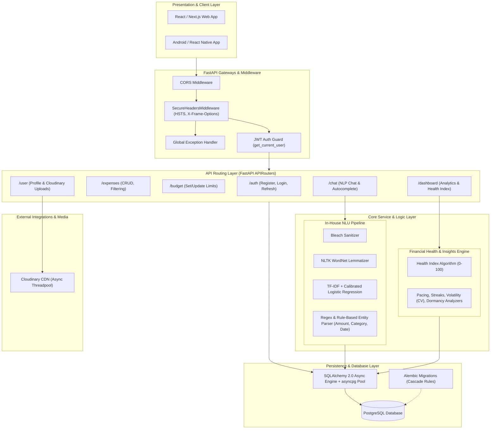
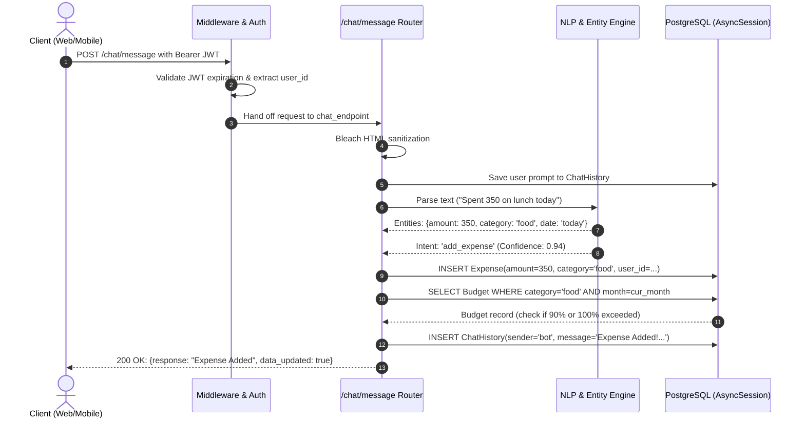
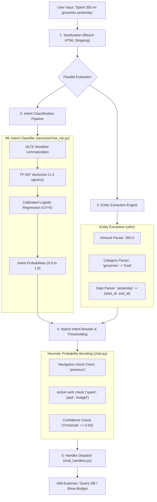

Here is a comprehensive, production-grade breakdown of the **SmartExp** architecture tailored specifically to help you ace your technical interview.

---

# 1. Executive Summary & "Elevator Pitch"

> **How to introduce the project in an interview:**  
> *"SmartExp is an AI-powered personal financial management and expense intelligence platform. It is architected as an asynchronous, modular backend using FastAPI, PostgreSQL (SQLModel/asyncpg), and Scikit-Learn. The platform features an in-house Natural Language Understanding (NLU) pipeline that parses natural conversational inputs into structured financial transactions, dynamic budget tracking, and an analytics engine calculating a weighted Financial Health Index based on spending volatility and savings rates."*

---

# 2. System Architecture Diagram

---

# 3. Layer-by-Layer Architectural Breakdown

### 1. Presentation & API Layer
- **Framework:** **FastAPI** running on **Uvicorn** (ASGI server).
- **Entry point:** [`app/main.py`](file:///c:/Users/User/abhishek/SmartExp/expense-tracker-backend/app/main.py).
- **Key Architectural Choices:**
  - **Asynchronous from the ground up:** All router functions utilize `async def` to maximize I/O concurrency without blocking worker threads.
  - **Middleware Hardening:** 
    - Custom [`SecureHeadersMiddleware`](file:///c:/Users/User/abhishek/SmartExp/expense-tracker-backend/app/main.py#L41-L49) injects `Strict-Transport-Security`, `X-Frame-Options: DENY`, and `X-Content-Type-Options: nosniff`.
    - Strict `CORSMiddleware` reading whitelist origins dynamically from environment variables.
  - **Centralized Exception Handling:** [`global_exception_handler`](file:///c:/Users/User/abhishek/SmartExp/expense-tracker-backend/app/main.py#L27-L38) standardizes error payload structure (`{"error": true, "message": "..."}`) while suppressing internal tracebacks when `DEBUG_MODE=false`.

---

### 2. Authentication & Security Layer
- **File:** [`app/auth.py`](file:///c:/Users/User/abhishek/SmartExp/expense-tracker-backend/app/auth.py)
- **Token Strategy (Dual-Token Pattern):**
  - **Access Token:** Short-lived JWT (15-minute expiration) signed via `HS256`, sent as `Authorization: Bearer <token>`.
  - **Refresh Token:** Long-lived JWT (7-day expiration) stored in an **`HttpOnly`**, **`Secure`**, **`SameSite=None`** cookie.
  - **Token Rotation:** The `/auth/refresh` endpoint validates the cookie payload, verifies user active status in PostgreSQL, and generates a fresh access token without re-prompting credentials.
- **Password Hashing:** Uses **`Argon2`** (via `passlib.context.CryptContext`), which provides superior resistance to GPU/ASIC brute-force attacks compared to standard bcrypt.

---

### 3. Data Persistence & Migration Layer
- **Files:** [`app/models.py`](file:///c:/Users/User/abhishek/SmartExp/expense-tracker-backend/app/models.py), [`app/database.py`](file:///c:/Users/User/abhishek/SmartExp/expense-tracker-backend/app/database.py), [`alembic/`](file:///c:/Users/User/abhishek/SmartExp/expense-tracker-backend/alembic)
- **ORM / Schema Union:** **SQLModel** (combines SQLAlchemy 2.0 and Pydantic v2).
  - Eliminates schema duplication: the same class acts as the ORM table definition and validation schema.
- **Connection Pool:** Async engine configured with `asyncpg` and `pool_pre_ping=True` to prune dead pooled connections before query dispatch.
- **Relational Integrity:**
  - `Users` is the parent entity with one-to-many relationships to `Expense`, `Budget`, `ChatHistory`, and `Income`.
  - Configured with `ondelete="CASCADE"` at both the database foreign-key level and SQLAlchemy relationship level (`cascade="all, delete-orphan"`), ensuring zero orphaned records upon user account deletion.

---

### 4. AI & Conversational NLU Engine
- **Files:** [`app/chat.py`](file:///c:/Users/User/abhishek/SmartExp/expense-tracker-backend/app/chat.py), [`app/services/chat_nlp.py`](file:///c:/Users/User/abhishek/SmartExp/expense-tracker-backend/app/services/chat_nlp.py), [`app/ml/train_intent_model.py`](file:///c:/Users/User/abhishek/SmartExp/expense-tracker-backend/app/ml/train_intent_model.py), [`app/utils/`](file:///c:/Users/User/abhishek/SmartExp/expense-tracker-backend/app/utils)
- **Problem Solved:** Allows users to log and query expenses in free text (e.g., *"spent 450 on groceries yesterday"*).
- **Pipeline Architecture:**
  1. **Input Sanitization:** Passed through **`bleach`** to neutralize HTML/XSS injection.
  2. **Entity Extraction ([`entity_extractor.py`](file:///c:/Users/User/abhishek/SmartExp/expense-tracker-backend/app/utils/entity_extractor.py)):**
     - Amount extraction (supporting currency symbols ₹, $, commas, abbreviations).
     - Semantic category mapping across standard categories (`food`, `travel`, `rent`, `shopping`, etc.).
     - Relative date resolution via [`date_parser.py`](file:///c:/Users/User/abhishek/SmartExp/expense-tracker-backend/app/utils/date_parser.py) (e.g., "last month", "yesterday", "week of 12 Oct").
  3. **Intent Classification ([`chat_nlp.py`](file:///c:/Users/User/abhishek/SmartExp/expense-tracker-backend/app/services/chat_nlp.py)):**
     - **Preprocessing:** NLTK WordNet lemmatization.
     - **ML Classifier:** Scikit-Learn `Pipeline` with `TfidfVectorizer(ngram_range=(1,2))` and `CalibratedClassifierCV(LogisticRegression())` to output well-calibrated class probabilities.
     - **Rule-based Boosting & Fallback:** Hybrid routing boosts probabilities based on verb and entity presence (e.g., navigation keywords like *"next week"* force expense listing).
     - **Fault Tolerance:** If the serialized model file is missing, the system gracefully falls back to deterministic rule-based matching without crashing.
  4. **Contextual History Navigation:** If a user says *"show next week"*, the bot inspects previous `ChatHistory` metadata to advance the date cursor.

---

### 5. Financial Analytics & Health Index Engine
- **Files:** [`app/dashboard.py`](file:///c:/Users/User/abhishek/SmartExp/expense-tracker-backend/app/dashboard.py), [`app/insights/engine.py`](file:///c:/Users/User/abhishek/SmartExp/expense-tracker-backend/app/insights/engine.py), [`app/insights/analyzers.py`](file:///c:/Users/User/abhishek/SmartExp/expense-tracker-backend/app/insights/analyzers.py)
- **Financial Health Score Algorithm (0 to 100):**  
  A weighted multi-factor financial scoring model:
  $$\text{Score} = \frac{0.30 \cdot S_{\text{savings}} + 0.20 \cdot S_{\text{expense}} + 0.15 \cdot S_{\text{stability}} + 0.15 \cdot S_{\text{budget}} + 0.20 \cdot S_{\text{income}}}{\text{Total Configured Weight}}$$
  
  - **Savings Strength (30%):** Evaluates savings rate $\frac{\text{Income} - \text{Spent}}{\text{Income}}$ ($\ge 30\%$ scores 100).
  - **Expense Sustainability (20%):** Measures total spending ratio against income ($\le 60\%$ scores 100).
  - **Expense Stability / Volatility (15%):** Calculates Coefficient of Variation:
    $$CV = \frac{\sigma}{\mu}$$
    *Edge Case Handling:* Implements **Low-Spend Immunity**—if total spend $< 1000$, volatility penalties are waived to reward frugality.
  - **Budget Discipline (15%):** Compares actual spend against category/overall budget allocations.
  - **Income Consistency (20%):** Measures volatility over a 6-month historical window.

- **Companion Analyzers:**
  - **Pacing Analyzer:** Flags premature budget depletion midway through the month ($t_{\text{day}} / t_{\text{month}}$).
  - **Streak & Milestones Analyzer:** Calculates multi-month budget adherence streaks.
  - **Dormancy & Velocity Analyzers:** Flags unusual spikes or inactive expense categories.

---

### 6. Media & External Cloud Storage
- **File:** [`app/users.py`](file:///c:/Users/User/abhishek/SmartExp/expense-tracker-backend/app/users.py)
- **Cloudinary Integration:** Used for hosting user profile avatars.
- **Concurrency Consideration:** Because Cloudinary's Python SDK is synchronous and blocking, uploads and deletions are wrapped in FastAPI's `run_in_threadpool(cloudinary.uploader.upload, ...)` to avoid blocking the main asyncio event loop.

---

# 4. End-to-End Request Lifecycle Example

Let’s trace a real scenario: **"Spent 350 on lunch today"** sent to `POST /chat/message`.

---

# 5. Top Architectural Interview Questions & Answers

### Q1: "Why did you choose FastAPI over Flask or Django?"
> **Answer:**  
> *"FastAPI is built natively on ASGI and Python type annotations, enabling asynchronous request handling with high throughput. In contrast to Django's heavy ORM overhead, FastAPI paired with SQLModel and asyncpg provides non-blocking database queries, automatic OpenAPI/Swagger documentation, and compile-time data validation through Pydantic v2. This is crucial for financial calculations and real-time chatbot interactions."*

### Q2: "How did you manage authentication and why use a dual-token strategy?"
> **Answer:**  
> *"We implemented a dual JWT token approach: short-lived 15-minute access tokens in the `Authorization: Bearer` header, and 7-day refresh tokens delivered via an `HttpOnly`, `Secure`, `SameSite=None` cookie. Storing the refresh token in an HttpOnly cookie protects against XSS attacks, while the short-lived access token limits the blast radius if intercepted. For password storage, we picked Argon2 over Bcrypt due to its memory-hard design resisting GPU-based offline cracking."*

### Q3: "Why build an in-house ML model for intent parsing instead of calling the OpenAI API?"
> **Answer:**  
> *"Three reasons: **Latency**, **Cost**, and **Data Privacy**.  
> 1. Running a local TF-IDF + Calibrated Logistic Regression pipeline executes in sub-10 milliseconds, whereas an external LLM roundtrip takes 500ms to 2 seconds.  
> 2. Zero operational API cost per chat interaction.  
> 3. User financial logs remain private within our own infrastructure without exposing transaction details to third-party model providers."*

### Q4: "How does the system ensure database operations don't block the asynchronous event loop?"
> **Answer:**  
> *"We use SQLAlchemy 2.0's `AsyncSession` with the `asyncpg` driver. All queries are executed with `await session.execute(...)` or `await session.commit()`. For any unavoidable synchronous dependencies—such as Cloudinary's upload SDK—we dispatch them via `run_in_threadpool`, ensuring the async worker threads remain free to process other concurrent HTTP requests."*

### Q5: "How does the Financial Health Index work and what edge cases did you handle?"
> **Answer:**  
> *"The Financial Health Index is an algorithmic scoring engine (0-100) combining 5 dimensions: Savings Rate (30%), Expense Ratio (20%), Spending Volatility (15%), Budget Adherence (15%), and Income Stability (20%).  
> For volatility, we calculate the Coefficient of Variation ($CV = \frac{\sigma}{\mu}$). A key edge case we handled is **'Low-Spend Immunity'**: standard volatility penalizes sporadic purchases, so a user spending very little overall might look erratic; we explicitly waive volatility penalties if total spend is under ₹1,000 to reward financial discipline."*

---

# 6. Suggested Discussion Points for Your Interview

1. **Database Schema & Cascades:** Mention how database migrations via Alembic enforce `ON DELETE CASCADE` so deleting an account cleans up expenses, budgets, chats, and Cloudinary media without dangling records.
2. **Graceful Fallbacks:** Highlight how the NLU pipeline uses calibrated probabilities and falls back to deterministic rule-based parsing if the ML artifact is unavailable.
3. **Frontend / Mobile Agnostic:** The REST API conforms strictly to standard HTTP status codes (200, 400, 401, 404, 409, 500) and cookie handling, enabling seamless integration with Web (React/Vite) and Mobile (Jetpack Compose / React Native).

--- ---

Here is a comprehensive breakdown of **how the NLP / NLU system works in SmartExp**, followed by the **most critical questions an interviewer can ask you** about this component and how to answer them.

---

# Part 1: How the NLP Works in SmartExp

The NLP module powers the conversational financial assistant (`/chat/message`). It takes raw user text (e.g., *"Spent 350 on groceries yesterday"* or *"How much did I spend on food last month?"*) and converts it into structured database actions.

The architecture uses a **Hybrid NLU Pipeline (Machine Learning + Rule-based Boosting + Deterministic Entity Extraction)**.

---

## The 4 Core Stages of the Pipeline

### 1. Text Preprocessing & Lemmatization
- **Files:** [`app/services/chat_nlp.py`](file:///c:/Users/User/abhishek/SmartExp/expense-tracker-backend/app/services/chat_nlp.py), [`app/ml/train_intent_model.py`](file:///c:/Users/User/abhishek/SmartExp/expense-tracker-backend/app/ml/train_intent_model.py)
- **Sanitization:** Input is filtered with `bleach.clean()` to eliminate HTML/script injections and capped at 500 characters.
- **Lemmatization:** Uses NLTK's `WordNetLemmatizer` with lazy loading.
  - *Why not stemming?* Stemming chops word endings roughly (e.g., "spending" $\to$ "spend", but "expenses" $\to$ "expens"). Lemmatization uses vocabulary and morphological analysis to return true dictionary roots (e.g., *"buying"*, *"bought"* $\to$ *"buy"*).

---

### 2. Machine Learning Intent Classification
- **Files:** [`app/ml/train_intent_model.py`](file:///c:/Users/User/abhishek/SmartExp/expense-tracker-backend/app/ml/train_intent_model.py), [`intent_dataset.csv`](file:///c:/Users/User/abhishek/SmartExp/expense-tracker-backend/app/ml/intent_dataset.csv)
- **Intents Supported:**
  1. `add_expense`: *"Bought coffee for 150"*
  2. `show_expenses`: *"Show my transactions this week"*
  3. `total_expenses`: *"How much did I spend in total?"*
  4. `set_budget`: *"Set a budget of 5000 for groceries"*
  5. `show_budget`: *"What is my budget status?"*
  6. `add_income`: *"My salary of 60000 was credited"*
  7. `unknown` / `fallback`: Anything outside the financial domain.
- **The Scikit-Learn Pipeline:**
  1. **`TfidfVectorizer(ngram_range=(1, 2), min_df=1, max_df=0.9)`**: Extracts unigrams and bigrams. Bigrams are essential for finance (e.g., *"not spent"* vs *"spent"*, or *"add expense"* vs *"show expense"*).
  2. **`LogisticRegression(class_weight="balanced")`**: Fast, linear, and works well on small-to-medium text datasets.
  3. **`CalibratedClassifierCV(..., method='sigmoid', cv=5)`**: Wraps Logistic Regression with Platt scaling. This turns raw decision boundary distances into **true, reliable probabilities** between `0.0` and `1.0`.

---

### 3. Entity Extraction (Slot Filling)
- **Files:** [`app/utils/entity_extractor.py`](file:///c:/Users/User/abhishek/SmartExp/expense-tracker-backend/app/utils/entity_extractor.py), [`app/utils/expense_parser.py`](file:///c:/Users/User/abhishek/SmartExp/expense-tracker-backend/app/utils/expense_parser.py), [`app/utils/date_parser.py`](file:///c:/Users/User/abhishek/SmartExp/expense-tracker-backend/app/utils/date_parser.py)
- Three slots are extracted simultaneously:
  - **Amount:** Regex parsing supporting variations (`"₹500"`, `"500rs"`, `"500.50"`, `"5k"` $\to$ `5000.0`).
  - **Category Mapping:** Semantic keyword dictionary mapping informal names to standard DB categories:
    - *"swiggy"*, *"mcdonalds"*, *"burger"*, *"dinner"* $\to$ `food`
    - *"uber"*, *"metro"*, *"petrol"*, *"flight"* $\to$ `travel` / `fuel`
    - *"netflix"*, *"movie"*, *"concert"* $\to$ `entertainment`
  - **Date Range Parsing:** Converts human relative dates to SQL timestamps:
    - *"today"*, *"yesterday"*, *"this week"*, *"last week"*, *"this month"*, *"last month"*, or explicit dates like *"15th Oct"*.

---

### 4. Hybrid Boosting, Fallback & Contextual Navigation
- **File:** [`app/chat.py`](file:///c:/Users/User/abhishek/SmartExp/expense-tracker-backend/app/chat.py#L145-L210)
- **Domain-Specific Probability Boosts:** Pure ML models sometimes misclassify short utterances. If entities exist, rules boost probability:
  - If text contains an amount AND category $\to$ `add_expense` gets $+0.2$ boost.
  - If text contains verbs like `"spent"`, `"paid"`, `"bought"` $\to$ `add_expense` gets $+0.4$ boost.
  - If text contains `"budget"`, `"cap"`, `"limit"` $\to$ `set_budget` gets $+0.4$ boost.
- **Thresholding:** If the highest winning intent probability is $< 0.50$ (`CONFIDENCE_THRESHOLD`), it switches to `fallback`.
- **Zero-Crash Fallback:** If the `.pkl` model file is missing or corrupted, [`predict_intent_rule_based()`](file:///c:/Users/User/abhishek/SmartExp/expense-tracker-backend/app/services/chat_nlp.py#L59-L88) takes over seamlessly.
- **Stateful Navigation:** When the user says *"show next week"* or *"previous month"*, the handler inspects the last bot response in `ChatHistory` (`JSON` column) to know what period was being viewed and slides the window forward or backward.

---

# Part 2: Interview Questions on this NLP Architecture & How to Answer

### Q1: "Why did you build an in-house Scikit-Learn NLP pipeline instead of using an LLM like OpenAI or Claude?"
> **How to answer:**  
> *"We evaluated both and chose an in-house model for three key production reasons:  
> 1. **Latency:** Local TF-IDF + Logistic Regression inference takes less than **5 milliseconds**, whereas an LLM API roundtrip takes 500ms to 2000ms.  
> 2. **Financial Privacy:** Expense data contains sensitive personal spending habits. Keeping NLP in-memory guarantees zero user financial data leaves our private backend.  
> 3. **Cost & Determinism:** LLM APIs have per-token billing and non-deterministic outputs that can hallucinate JSON formats. Our pipeline gives 100% deterministic slot filling with zero external API fees."*

---

### Q2: "Why did you use `CalibratedClassifierCV` instead of standard Logistic Regression?"
> **How to answer:**  
> *"Standard Logistic Regression outputs scores via the sigmoid function, but when regularization ($L_2$) is applied, those scores are distorted and don't reflect true class probabilities.  
> By wrapping it in `CalibratedClassifierCV` using 5-fold cross-validation and Platt's sigmoid method, the output probabilities are calibrated against real likelihoods. This allowed us to set a dependable **confidence threshold (0.50)**. If confidence is below 50%, we can reliably trigger a fallback instead of executing a wrong financial transaction."*

---

### Q3: "What is the difference between Lemmatization and Stemming, and why did you choose Lemmatization?"
> **How to answer:**  
> *"Stemming is a heuristic, rule-based approach (like Porter Stemmer) that chops suffixes off words, often creating non-words (e.g., 'expenses' becomes 'expens', 'university' becomes 'univers').  
> Lemmatization uses a morphological dictionary (NLTK WordNet) to resolve words to their meaningful lemma or base form (e.g., 'bought' $\to$ 'buy', 'spent' $\to$ 'spend'). For intent classification, preserving semantic meaning is critical to matching variations of spending and budgeting commands."*

---

### Q4: "Why use N-grams `(1, 2)` instead of just single words in TF-IDF?"
> **How to answer:**  
> *"Single words (unigrams) lose negation and phrase context. For example:  
> - 'show' and 'expense' separately could mean adding or listing, but the bigram `'show expense'` specifically indicates querying.  
> - Similarly, bigrams like `'set budget'` or `'last month'` convey intent and date ranges that individual words cannot represent alone."*

---

### Q5: "How does the system handle ambiguity, typos, or unseen words?"
> **How to answer:**  
> *"We built a multi-layered defense:  
> 1. **TF-IDF + Sub-linear scaling:** Unseen words simply receive zero TF-IDF weights, allowing familiar keywords to dominate the score.  
> 2. **Probability Boosting:** If someone types informal phrasing like 'dropped 200 on pizza', even if the ML classifier has borderline confidence, our entity extractor spots the amount (200) and food keyword ('pizza'), boosting `add_expense`.  
> 3. **Graceful Fallback:** If confidence stays below 0.50, the bot returns a friendly prompt with sample commands rather than executing an erroneous transaction.  
> 4. **Autocomplete Suggestions Endpoint (`/chat/suggestions`):** We guide users toward valid input patterns before they even hit Enter by suggesting dynamic templates and historical queries."*

---

### Q6: "How does the chatbot handle multi-turn conversational context?"
> **How to answer:**  
> *"We store conversational metadata in PostgreSQL inside the `ChatHistory.data` JSON column.  
> For instance, when a user asks 'Show my expenses this week', the bot saves the query payload (`start_date`, `end_date`, `period_type="week"`) in the DB. When the user follows up with 'show next week' or 'previous', the handler queries the last bot interaction, extracts the prior date window, and shifts the start and end dates by 7 days dynamically."*

---

### Q7: "If this service scales to 100,000 users, what are the bottlenecks in this NLP design and how would you scale it?"
> **How to answer:**  
> *"1. **Model Loading:** Currently, the model is loaded in-memory inside the FastAPI process. Since it is small (~few MBs), each Uvicorn worker process holds a copy without memory issues.  
> 2. **Scaling Path:** If vocabulary and dataset size grow significantly, we would decouple the NLU into a standalone lightweight microservice (or Triton inference server / TorchServe) communicating via gRPC or Redis pub/sub.  
> 3. **Model Upgrades:** For more complex entity extraction, we could replace regex/dictionaries with a fine-tuned small spaCy model or distilled transformer (like DistilBERT) with ONNX Runtime for high-speed CPU inference."*

--- --- --- ---

Here is the machine learning part explained in **plain, simple English**—the way you can explain it naturally to an interviewer without getting tangled up in heavy math or jargon.

---

### The Big Picture: What does the ML actually do?
When a user types a message like:
> *"Ate pizza for 300 rupees yesterday"*

The computer only sees a bunch of letters. The machine learning model's only job is to answer **one simple question**:  
**"What does this user want to do?"** (Their **Intent**).

Does the user want to:
- Add a new expense?
- Check total spending?
- See a list of expenses?
- Set a monthly budget?
- Or are they just talking random stuff?

---

### Step-by-Step: How the ML works in simple words

#### 1. Cleaning the words (Lemmatization)
People say the same thing in different ways:
- *"I spent 200"*
- *"I am spending 200"*
- *"I spend 200"*

Computers treat *"spent"*, *"spending"*, and *"spend"* as three completely different words unless we clean them.  
**What we do:** We use a tool called **Lemmatizer** (from NLTK). It acts like a dictionary that converts all variations back to their base root:  
👉 *"spent"*, *"spending"* $\to$ **`spend`**  
👉 *"bought"*, *"buying"* $\to$ **`buy`**  

This makes the text consistent and easy for the computer to recognize.

---

#### 2. Turning words into numbers (TF-IDF Vectorizer)
Computers cannot understand words—they only understand numbers.

**TF-IDF** does two simple things:
1. **Counts how often a word appears** in the sentence.
2. **Gives more importance to special words** and less importance to common filler words.
   - Common words like *"the"*, *"is"*, *"for"* appear everywhere, so it gives them very low scores.
   - Action words like *"bought"*, *"budget"*, *"spent"* are unique clues, so it gives them high scores.

We also told it to look at **pairs of two words together (bigrams)**:
- The single word *"budget"* could mean anything.
- But the pair of words **`"set budget"`** clearly means the user wants to configure a spending limit.

---

#### 3. Guessing the category (Logistic Regression)
Now that the sentence is turned into numbers, our classifier (**Logistic Regression**) looks at the numbers and makes a decision.

Think of it like a detective weighing clues:
- Found clues like `spend`, `coffee`, `paid` $\to$ The model says: *"There is a 92% chance they want to **add an expense**."*
- Found clues like `how much`, `total` $\to$ The model says: *"There is an 88% chance they want to **see total expenses**."*

---

#### 4. Double-checking honesty (Calibrated Classifier)
Sometimes machine learning models are overconfident—they might say *"I am 99% sure"* even when they are just guessing.

We wrapped our model in **`CalibratedClassifierCV`**.  
Think of this as a **truth filter**. It makes sure that if the model says *"I am 80% confident"*, it really means it is right 8 out of 10 times.

- If confidence is **high ($\ge 50\%$)**: We go ahead and run the action.
- If confidence is **too low ($< 50\%$)**: The bot honestly says: *"Sorry, I didn't quite get that. Here are some examples of what you can ask me."* (It prevents accidentally adding wrong expenses to the database!).

---

#### 5. Safety Net (Rule-Based Fallback)
What if the machine learning model file fails to load or goes missing?
- The backend **does not crash**.
- We wrote a simple backup system that checks basic keywords (like *"spent"*, *"budget"*, *"total"*) so the app continues working smoothly.

---

### How to say this in an interview (60-second summary)

> *"In simple terms, our ML model classifies the user's intent from their chat message.*  
> *First, we clean the sentence using lemmatization so words like 'bought' and 'buying' both become 'buy'.*  
> *Next, we convert the text into numbers using TF-IDF, which highlights important words like 'spent' or 'budget'.*  
> *Then, a Logistic Regression model calculates the probability of each action—like adding an expense or checking a budget.*  
> *Finally, we calibrated the probabilities so that if the model's confidence is below 50%, it asks the user for clarification rather than saving incorrect data."*

--- --- --- ---

Here is the ultimate master list of **real-world interview questions** you can be asked about this project across all categories (Architecture, Database, Security, Backend Logic, Financial Analytics, and System Design), along with the **exact, straightforward answers** you should give.

---

# Category 1: High-Level Architecture & Tech Stack

### 1. "Can you walk me through the high-level architecture of your project?"
**Answer:**
> *"The backend is built as an asynchronous modular REST API using FastAPI and Python.  
> We use PostgreSQL for data storage via SQLModel and the asyncpg driver.  
> The system has 4 key layers:  
> 1. **API & Middleware Layer:** Handles authentication, CORS, security headers, and request validation.  
> 2. **Conversational NLU Engine:** An in-house NLP model using TF-IDF and calibrated Logistic Regression to convert natural chat into expense entries.  
> 3. **Financial Intelligence Engine:** Calculates real-time analytics like a weighted Financial Health Score (0-100), spending trends, and budget pacing.  
> 4. **Persistence Layer:** PostgreSQL with cascading relationships and Alembic for automated migrations."*

---

### 2. "Why did you pick FastAPI instead of Django or Flask?"
**Answer:**
> *"Three reasons:  
> 1. **Native Async Support:** FastAPI is built on ASGI (`async/await`), so database queries and API calls run concurrently without blocking worker threads.  
> 2. **Pydantic Validation:** Request payloads and database models are validated automatically at runtime.  
> 3. **Automatic OpenAPI/Swagger Docs:** It provides interactive API documentation out of the box, making frontend integration much faster."*

---

### 3. "What happens if your server crashes or restarts? How does the database stay in sync?"
**Answer:**
> *"We use **Alembic** as our migration tool. When the server boots up, FastAPI executes the `create_db()` hook, and Alembic version scripts ensure all tables, constraints, and cascading rules match our SQLModel code. Since PostgreSQL persists data on disk, state is completely preserved across restarts."*

---

# Category 2: Authentication & Security

### 4. "How does authentication work in your application?"
**Answer:**
> *"We implemented a **Dual-Token JWT pattern**:  
> - **Access Token:** Short-lived (15 minutes), passed in the `Authorization: Bearer <token>` header for day-to-day API requests.  
> - **Refresh Token:** Long-lived (7 days), stored in an **`HttpOnly`**, **`Secure`**, **`SameSite=None`** cookie.  
> When the access token expires, the client calls `/auth/refresh`. The server reads the cookie, verifies the user in the database, and issues a new access token without making the user log in again."*

---

### 5. "Why store the refresh token in an `HttpOnly` cookie instead of LocalStorage?"
**Answer:**
> *"If you store tokens in JavaScript `localStorage`, any Cross-Site Scripting (XSS) vulnerability allows an attacker's script to steal the token.  
> An `HttpOnly` cookie cannot be read or accessed by JavaScript at all—the browser automatically attaches it only to requests going to the server. This completely neutralizes XSS token theft."*

---

### 6. "What password hashing algorithm did you use and why?"
**Answer:**
> *"We chose **Argon2** (via `passlib`) instead of standard MD5, SHA256, or basic Bcrypt.  
> Argon2 won the Password Hashing Competition (PHC). It is memory-hard and time-hard, meaning it requires significant RAM and CPU to compute, making it practically immune to modern GPU-based brute-force attacks."*

---

### 7. "How do you protect your chat endpoint from malicious input or XSS?"
**Answer:**
> *"We sanitize incoming text using Python's **`bleach`** library (`bleach.clean`), stripping out any HTML tags, Javascript, or attributes. We also enforce a strict 500-character limit on each message to prevent denial-of-service (DoS) payload attacks."*

---

# Category 3: Database & Performance

### 8. "What ORM did you use, and why SQLModel?"
**Answer:**
> *"We used **SQLModel**, which bridges **SQLAlchemy 2.0** and **Pydantic**.  
> Traditionally, in FastAPI + SQLAlchemy, you have to write two separate classes for the same table: a Pydantic schema for API validation, and a SQLAlchemy model for the database. SQLModel combines both into a single class, eliminating boilerplate code while preserving full async support."*

---

### 9. "What are cascading deletes and how did you configure them?"
**Answer:**
> *"A user owns expenses, budgets, chat history, and incomes. If a user deletes their account, we don't want orphaned records taking up database space.  
> We configured `ondelete='CASCADE'` on all foreign keys in both Alembic migrations and SQLAlchemy relationships (`cascade='all, delete-orphan'`). When a user is deleted, all their child rows in the other 4 tables are automatically deleted in one single atomic transaction."*

---

### 10. "Why did you add `pool_pre_ping=True` in your database engine?"
**Answer:**
> *"In production cloud environments (like Render or Supabase), the database server can close idle connections after a timeout.  
> Without `pool_pre_ping=True`, the backend would try to use a dead connection from its pool and throw a `500 Server Error`. With pre-ping enabled, the pool sends a quick test ping (`SELECT 1`) to ensure the connection is alive before handing it to a query."*

---

# Category 4: The Chatbot & Machine Learning

### 11. "Can you explain how a user's chat message is processed from start to finish?"
**Answer:**
> *"When a message arrives at `POST /chat/message`:  
> 1. **Sanitization:** Bleach removes any HTML or harmful scripts.  
> 2. **Entity Extraction:** A regex and keyword parser extracts the amount (e.g., 500), category (e.g., food), and relative date (e.g., yesterday).  
> 3. **Intent Classification:** The text is lemmatized, vectorised via TF-IDF, and evaluated by a calibrated Logistic Regression model to find what the user wants (e.g., `add_expense`).  
> 4. **Execution:** The handler saves the transaction to the `Expense` table and checks if this purchase crossed any budget limit.  
> 5. **Response:** A friendly formatted message is returned and logged in `ChatHistory`."*

---

### 12. "What happens if a user types something completely unrelated, like 'What is the weather today'?"
**Answer:**
> *"Our ML model outputs a calibrated probability for each intent. If the highest confidence score is below **0.50 (50%)**, the system categorizes the intent as `unknown` or `fallback`.  
> Instead of crashing or guessing wrongly, the bot politely responds with instructions and examples of what commands it supports (like adding expenses or checking budgets)."*

---

### 13. "How does the bot remember conversation context (like saying 'show next week')?"
**Answer:**
> *"We store state in the `ChatHistory` table under a PostgreSQL `JSON` column called `data`.  
> When the user asks for 'expenses this week', we save the date boundaries in that message's data. If their next message is 'show next week', the bot queries the user's latest interaction, reads the previous dates, shifts them forward by 7 days, and displays the new data without asking the user to retype the full query."*

---

# Category 5: Business Logic & Analytics

### 14. "How does the Financial Health Score work?"
**Answer:**
> *"It is a weighted 0-to-100 score inspired by financial advisory rules, calculated across 5 dimensions:  
> 1. **Savings Rate (30% weight):** Are you saving $\ge 30\%$ of your income?  
> 2. **Expense Sustainability (20% weight):** Is your spending $\le 60\%$ of income?  
> 3. **Spending Stability (15% weight):** Uses Coefficient of Variation ($CV = \frac{\sigma}{\mu}$) to measure daily spending volatility.  
> 4. **Budget Discipline (15% weight):** Are you staying within your set limits?  
> 5. **Income Consistency (20% weight):** How steady has income been over the last 6 months?  
> If total spending is under ₹1,000, we apply **'Low-Spend Immunity'** so disciplined, low spenders aren't penalized for volatility."*

---

### 15. "How do proactive budget warnings work?"
**Answer:**
> *"Whenever an expense is logged—either through the standard REST endpoint or the chat assistant—the service queries the user's active monthly budget.  
> If the new purchase pushes their category spend over **90%**, the bot appends an orange warning: `'Approaching budget limit'`. If it crosses **100%**, it triggers a red alert: `'Budget exceeded'`."*

---

# Category 6: Cloudinary, Concurrency & Scaling

### 16. "Cloudinary's Python SDK is synchronous. How did you prevent it from blocking your async FastAPI server?"
**Answer:**
> *"Because Python's standard `cloudinary.uploader.upload` function is synchronous, calling it directly inside an `async def` endpoint would freeze the entire event loop while the file uploaded.  
> To prevent this, we wrapped the call using `await run_in_threadpool(cloudinary.uploader.upload, ...)`. This offloads the file upload to a background thread pool, leaving FastAPI's async event loop free to handle other requests."*

---

### 17. "If traffic grew to 500,000 users, what would you optimize first?"
**Answer:**
> *"1. **Caching with Redis:** Dashboard aggregations and category spend queries repeat frequently. We can cache dashboard results with a 5-minute TTL, invalidating the cache only when a new expense is logged.  
> 2. **Database Read Replicas & Indexing:** Direct heavy analytics queries to read replicas. We already have composite indices on `(user_id, created_at)` and `(user_id, category)` to ensure fast queries.  
> 3. **Dedicated Worker Queues:** Offload profile picture resizing and long-term financial report generation to background workers using Celery or ARQ."*

---

### 💡 Tip for your interview:
When answering, structure your replies with **"What we did $\to$ Why we did it $\to$ What benefit it provided"**. This shows senior-level architectural thinking rather than just code memorization!